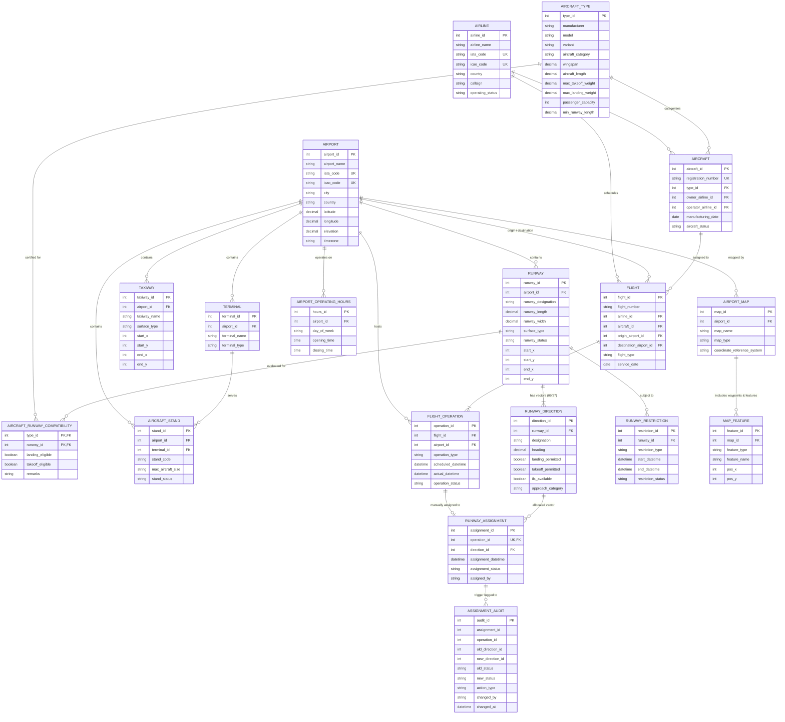

# AURORA — Entity-Relationship (ER) Schema Diagram
### Aircraft & Unified Runway Operations Records Archive
*MySQL 8.0+ / 8.4 LTS InnoDB Normalized Relational Architecture*

---

## 1. High-Level Entity-Relationship Model (Mermaid ERD)

---

## 2. Cardinality and Relationship Analysis

| Parent Entity | Child Entity | Cardinality | Business Semantics |
| :--- | :--- | :---: | :--- |
| `AIRPORT` | `RUNWAY` | 1 : N | An airport manages 1 or more physical runways. |
| `RUNWAY` | `RUNWAY_DIRECTION` | 1 : N (typically 1:2) | Each physical runway strip encompasses opposite directional vectors (e.g. 09 and 27). |
| `AIRPORT` | `TAXIWAY` | 1 : N | Aerodromes maintain named surface taxi links. |
| `AIRPORT` | `TERMINAL` | 1 : N | Passenger and cargo terminal facilities. |
| `TERMINAL` | `AIRCRAFT_STAND` | 1 : N (optional) | Parking stands/gates affiliated with terminals. |
| `AIRCRAFT_TYPE` | `AIRCRAFT` | 1 : N | Certified specifications instantiated by physical airframes. |
| `AIRLINE` | `AIRCRAFT` | 1 : N | Airlines own and operate specific airframes. |
| `FLIGHT` | `FLIGHT_OPERATION` | 1 : N (typically 1:2) | A scheduled flight splits into distinct takeoff and landing events. |
| `FLIGHT_OPERATION` | `RUNWAY_ASSIGNMENT` | 1 : 1 (or 1:0) | Each operation has at most one current manual runway assignment. |
| `RUNWAY_DIRECTION` | `RUNWAY_ASSIGNMENT` | 1 : N | Directions accept multiple sequential flight operations. |
| `AIRCRAFT_TYPE` + `RUNWAY` | `AIRCRAFT_RUNWAY_COMPATIBILITY` | M : N | Composite bridge validating airframe-to-runway suitability. |
| `RUNWAY` | `RUNWAY_RESTRICTION` | 1 : N | Scheduled closures, maintenance windows, and curfews. |
| `RUNWAY_ASSIGNMENT` | `ASSIGNMENT_AUDIT` | 1 : N | Audit log populated automatically via MySQL database triggers. |
